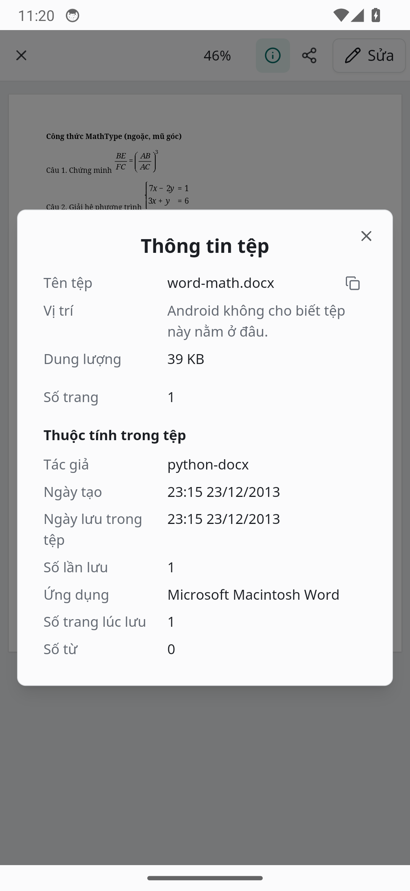
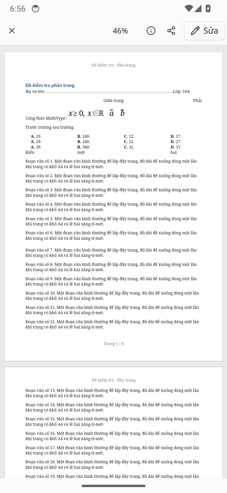
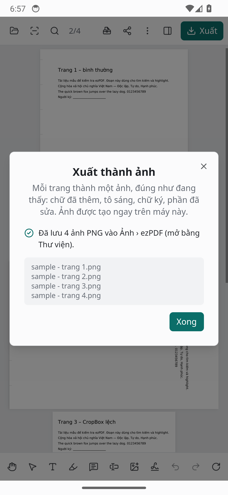
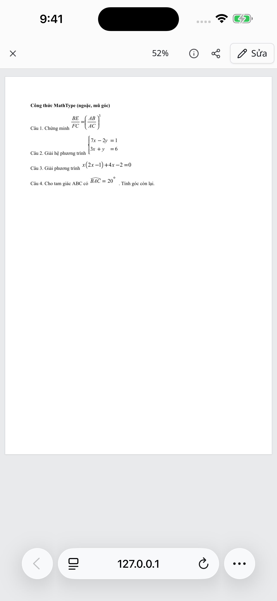
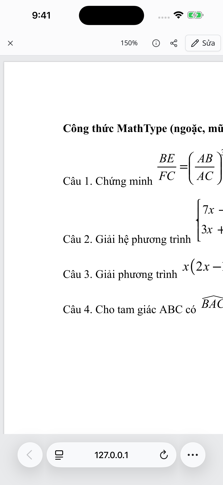
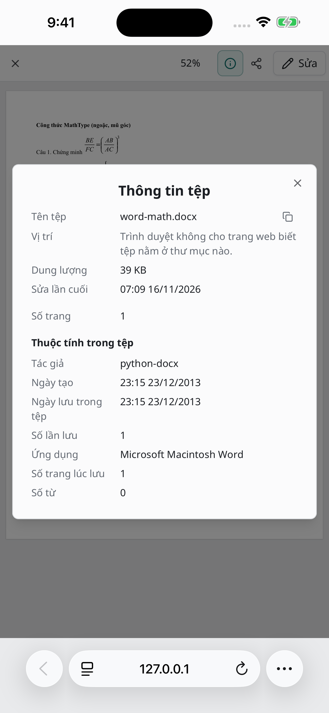
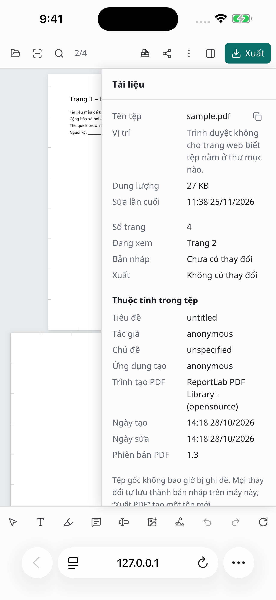
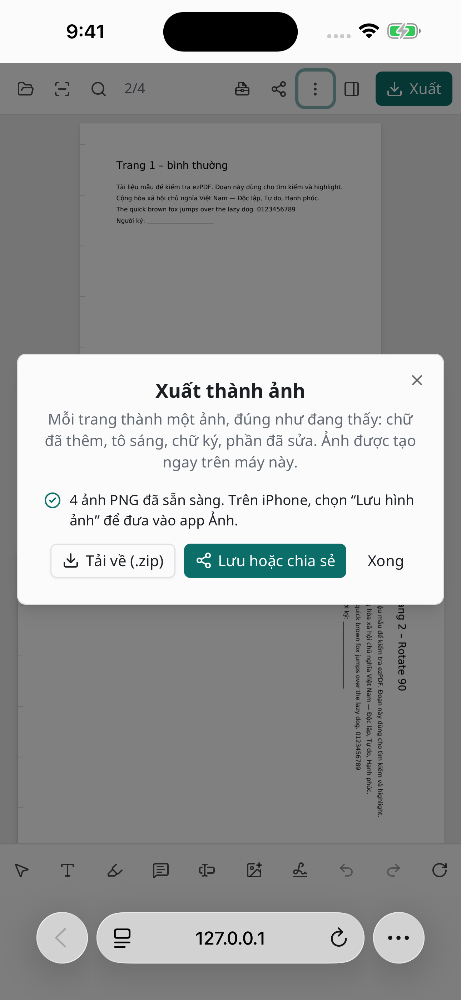
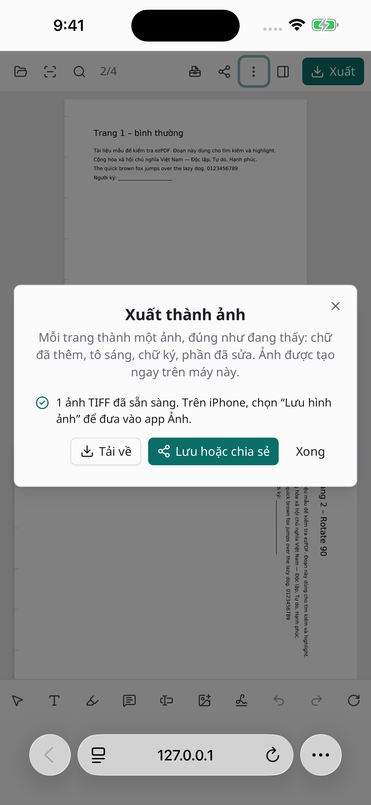

# Ảnh chụp ezPDF trên máy ảo (bản c626f44)

Chụp tự động sau lần đẩy lên main lúc 18:40 25/11/2026. Tệp mở ra là tệp thử trong tests/fixtures.

## Android (APK, màn hình như Galaxy S24 Ultra)

**Màn hình đầu**

Nhật ký: 19 s: pointer: coarse = true (điện thoại thật: true)


**Công thức MathType: ngoặc tròn, ngoặc nhọn, mũ góc**

Nhật ký: 28 s: trang của WebView đã đóng · 28 s: ảnh 2-word-math: Target page closed after the steps; làm lại · 29 s: logcat: 11-25 11:20:33.267 3584 3584 V Capacitor/Plugin: To native (Capacitor plugin): callbackId: 25706389, pluginId: EzFiles, methodName: takeIncoming / 11-25 11:20:33.267 3584 3584 V Capacitor: callback: 25706389, pluginId: EzFiles, methodName: takeIncoming, methodData: {} / 11-25 11:20:33.269 3584 3584 I Capacitor/Console: File: - Line 349 - Msg: [object Object] / 11-25 11:20:33.269 3584 3584 V Capacitor/Plugin: To native (Capacitor plugin): callbackId: 25706390, pluginId: EzFiles, methodName: clearCaptures / 11-25 11:20:33.269 3584 3584 V Capacitor: callback: 25706390, pluginId: EzFiles, methodName: clearCaptures, methodData: {} / 11-25 11:20:33.459 3584 3812 D Capacitor: Handling local request: https://localhost/fonts/ezSansVN-Regular.ttf / 11-25 11:20:33.506 3584 3584 I Capacitor/Console: File: - Line 333 - Msg: {"files":[]} / 11-25 11:20:33.506 3584 3584 I Capacitor/Console: File: - Line 333 - Msg: {"removed":0} · 29 s: dùng trang mới của WebView


**Các công thức đó, phóng to 150%**


**Thông tin tệp Word**



**Đề có điểm dừng tab, bảng, công thức**



**Tệp PDF và bảng thông tin**


**Xuất thành ảnh (trong ⋮): định dạng, trang, độ phân giải**


**Ảnh PNG của mọi trang: Android lưu vào Ảnh › ezPDF, iPhone đưa qua “Lưu hoặc chia sẻ”**

Ứng dụng báo: Đã lưu 4 ảnh PNG vào Ảnh › ezPDF (mở bằng Thư viện).

Trong /sdcard/Pictures/ezPDF:

```
total 440
-rwxrwx--- 1 u0_a176 media_rw  93146 2026-11-25 11:21 sample\ -\ trang\ 1.png
-rwxrwx--- 1 u0_a176 media_rw 128090 2026-11-25 11:21 sample\ -\ trang\ 2.png
-rwxrwx--- 1 u0_a176 media_rw  81771 2026-11-25 11:21 sample\ -\ trang\ 3.png
-rwxrwx--- 1 u0_a176 media_rw 126766 2026-11-25 11:21 sample\ -\ trang\ 4.png
```

Thư viện ảnh/tệp của Android (MediaStore):

```
Row: 0 _display_name=sample - trang 1.png, relative_path=Pictures/ezPDF/, mime_type=image/png, is_pending=0
Row: 1 _display_name=sample - trang 2.png, relative_path=Pictures/ezPDF/, mime_type=image/png, is_pending=0
Row: 2 _display_name=sample - trang 3.png, relative_path=Pictures/ezPDF/, mime_type=image/png, is_pending=0
Row: 3 _display_name=sample - trang 4.png, relative_path=Pictures/ezPDF/, mime_type=image/png, is_pending=0
```



**Một tệp TIFF nhiều trang: Android lưu vào Tải xuống › ezPDF**

Ứng dụng báo: Đã lưu 1 ảnh TIFF vào Tải xuống › ezPDF (mở bằng Tệp của tôi).

Trong /sdcard/Download/ezPDF:

```
total 404
-rwxrwx--- 1 u0_a176 media_rw 408686 2026-11-25 11:21 sample.tif
```

Thư viện ảnh/tệp của Android (MediaStore):

```
Row: 0 _display_name=sample.tif, relative_path=Download/ezPDF/, mime_type=image/tiff, is_pending=0
```


## iPhone 15 Pro Max (Safari, bản web)

**Màn hình đầu**


**Công thức MathType: ngoặc tròn, ngoặc nhọn, mũ góc**



**Các công thức đó, phóng to 150%**



**Thông tin tệp Word**



**Đề có điểm dừng tab, bảng, công thức**


**Tệp PDF và bảng thông tin**



**Xuất thành ảnh (trong ⋮): định dạng, trang, độ phân giải**


**Ảnh PNG của mọi trang: Android lưu vào Ảnh › ezPDF, iPhone đưa qua “Lưu hoặc chia sẻ”**

Ứng dụng báo: 4 ảnh PNG đã sẵn sàng. Trên iPhone, chọn “Lưu hình ảnh” để đưa vào app Ảnh.



**Một tệp TIFF nhiều trang: Android lưu vào Tải xuống › ezPDF**

Ứng dụng báo: 1 ảnh TIFF đã sẵn sàng. Trên iPhone, chọn “Lưu hình ảnh” để đưa vào app Ảnh.



