# Ảnh chụp ezPDF trên máy ảo (bản 34f23f4)

Chụp tự động sau lần đẩy lên main lúc 03:33 04/11/2026. Tệp mở ra là tệp thử trong tests/fixtures.

## Android (APK, màn hình như Galaxy S24 Ultra)

**Màn hình đầu**

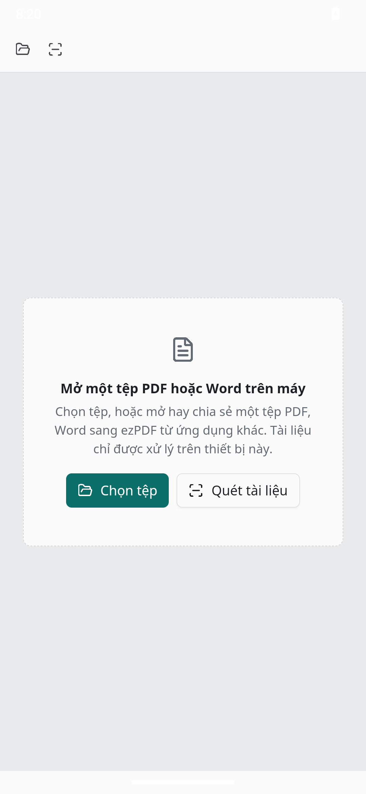

**Công thức MathType: ngoặc tròn, ngoặc nhọn, mũ góc** (lỗi: page.$: Target page, context or browser has been closed)

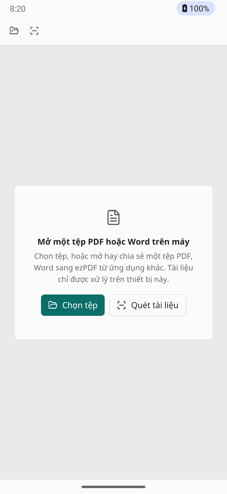

**Các công thức đó, phóng to 150%** (lỗi: page.$: Target page, context or browser has been closed)

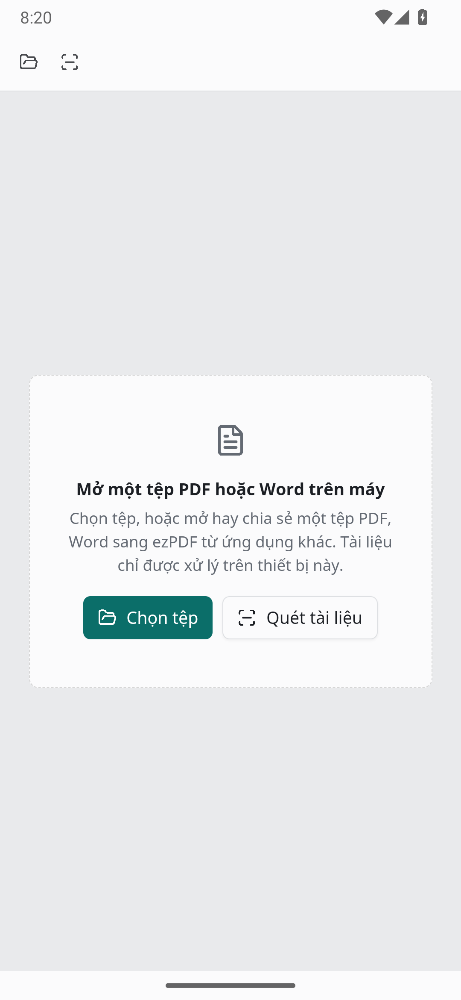

**Thông tin tệp Word** (lỗi: page.$: Target page, context or browser has been closed)

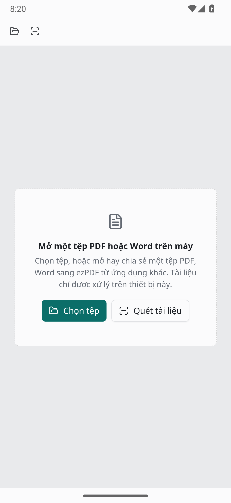

**Đề có điểm dừng tab, bảng, công thức** (lỗi: page.$: Target page, context or browser has been closed)

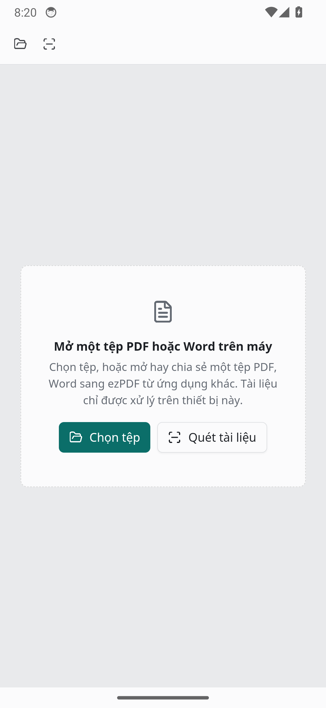

**Tệp PDF và bảng thông tin** (lỗi: page.$: Target page, context or browser has been closed)

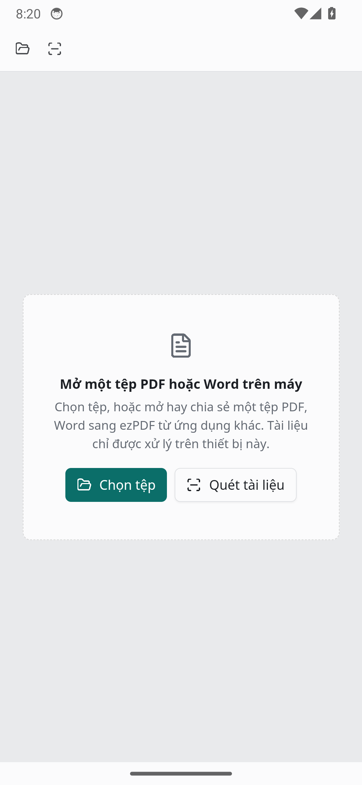

## iPhone 15 Pro Max (Safari, bản web)

**Màn hình đầu**

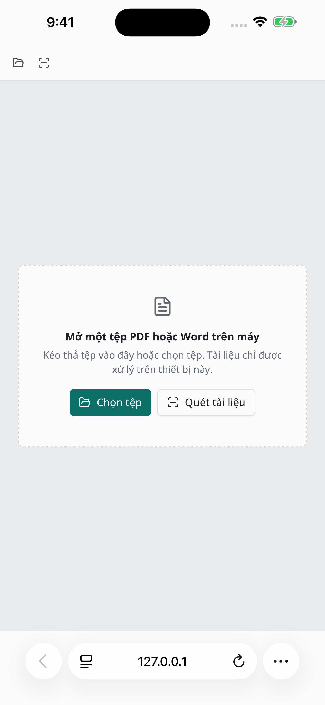

**Công thức MathType: ngoặc tròn, ngoặc nhọn, mũ góc**

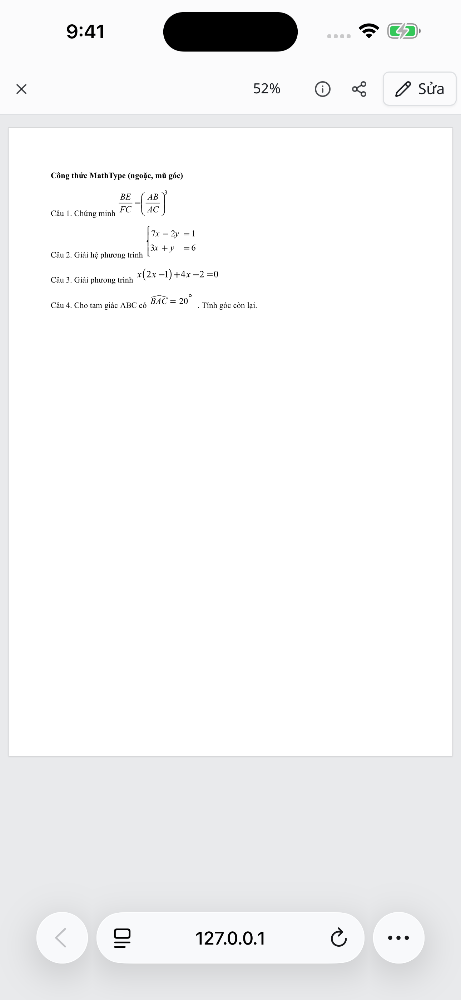

**Các công thức đó, phóng to 150%**

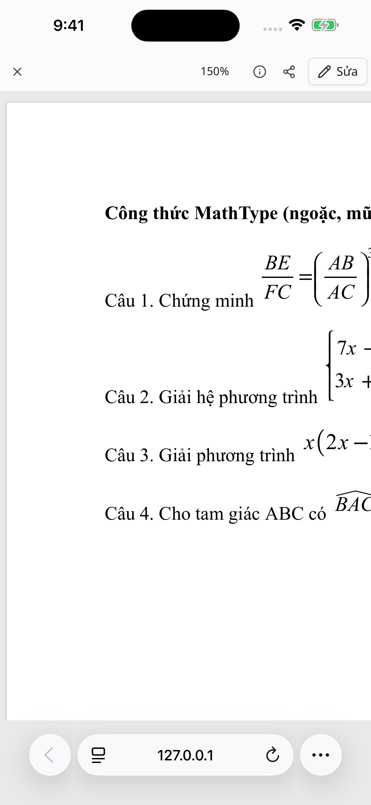

**Thông tin tệp Word**

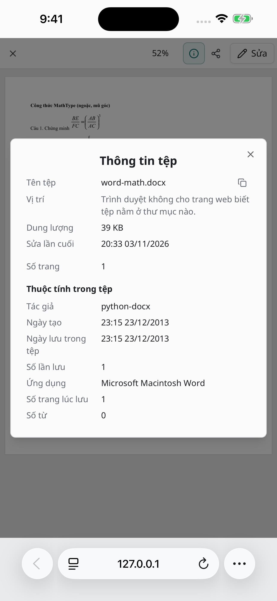

**Đề có điểm dừng tab, bảng, công thức**

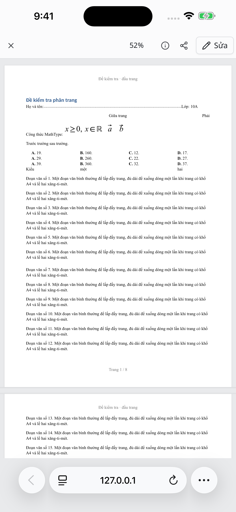

**Tệp PDF và bảng thông tin**

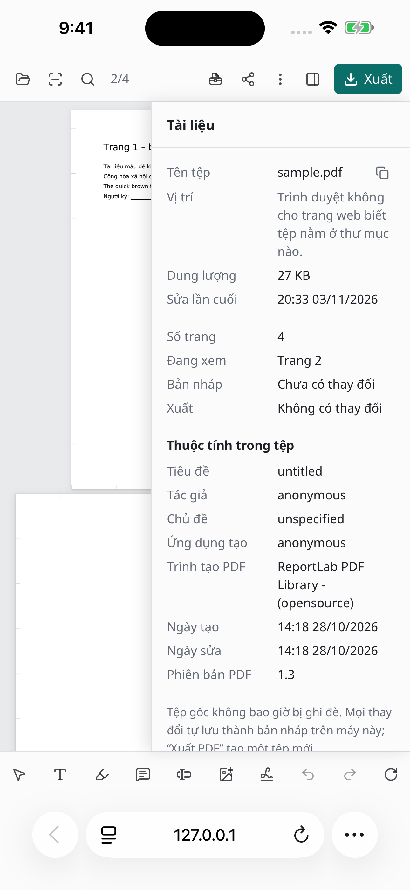

