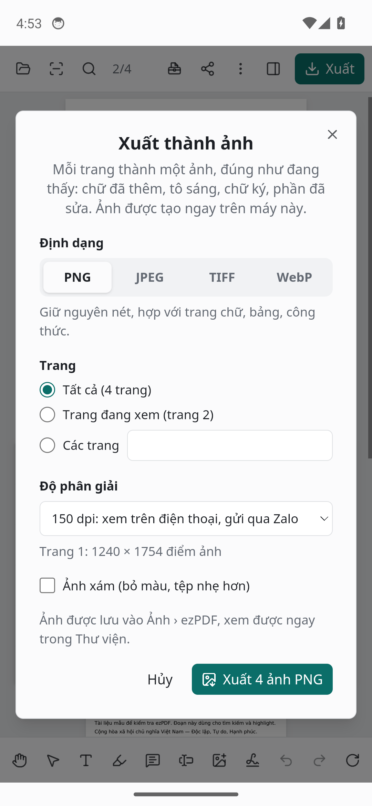
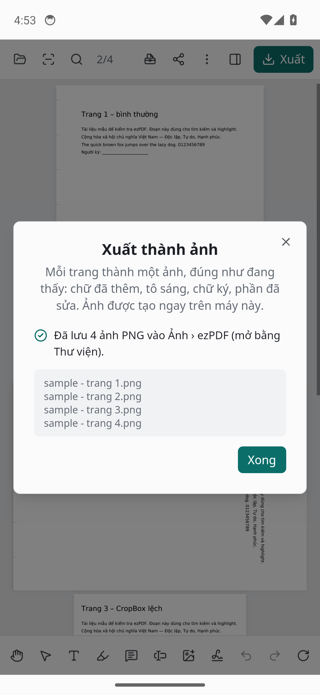
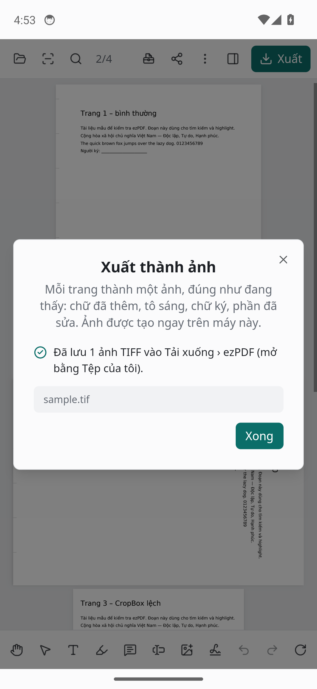
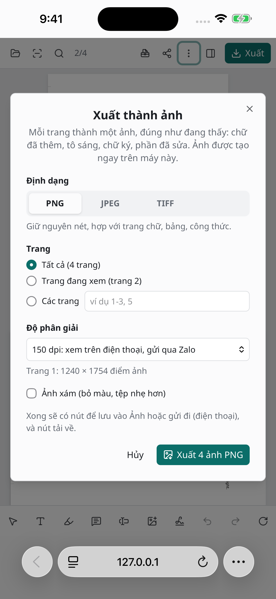
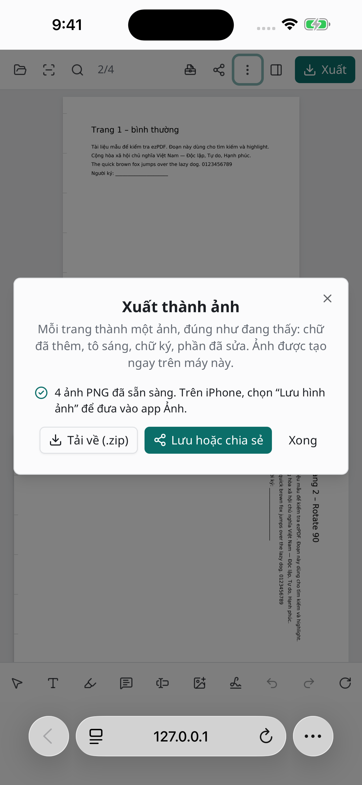
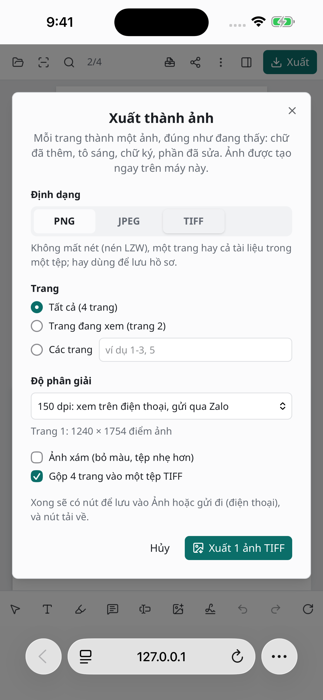

# Ảnh chụp ezPDF trên máy ảo (bản e60f3b1)

Chụp tự động sau lần đẩy lên main lúc 00:06 15/11/2026. Tệp mở ra là tệp thử trong tests/fixtures.

## Android (APK, màn hình như Galaxy S24 Ultra)

**Màn hình đầu**

Nhật ký: 20 s: pointer: coarse = true (điện thoại thật: true)


**Công thức MathType: ngoặc tròn, ngoặc nhọn, mũ góc**

Nhật ký: 33 s: trang của WebView đã đóng · 33 s: ảnh 2-word-math: page.evaluate: Target page, context or browser has been closed; làm lại · 33 s: logcat: 11-14 16:52:05.824 3924 3924 D Capacitor: Loading app at https://localhost / 11-14 16:52:05.868 3924 3924 D Capacitor: App started / 11-14 16:52:05.871 3924 3924 D Capacitor: App resumed / 11-14 16:52:05.879 3924 4068 D Capacitor: Handling local request: https://localhost/ / 11-14 16:52:05.937 3924 3924 W cr_AwContents: at com.getcapacitor.cordova.MockCordovaWebViewImpl.lambda$eval$0(MockCordovaWebViewImpl.java:189) / 11-14 16:52:05.937 3924 3924 W cr_AwContents: at com.getcapacitor.cordova.MockCordovaWebViewImpl.$r8$lambda$4KdV8CYlWQxu6zbahMKlKsvDFpM(Unknown Source:0) / 11-14 16:52:05.937 3924 3924 W cr_AwContents: at com.getcapacitor.cordova.MockCordovaWebViewImpl$$ExternalSyntheticLambda1.run(D8$$SyntheticClass:0) / 11-14 16:52:05.958 3924 4068 D Capacitor: Handling local request: https://localhost/assets/index-Ia3A1uD3.js · 33 s: dùng trang mới của WebView


**Các công thức đó, phóng to 150%**


**Thông tin tệp Word**


**Đề có điểm dừng tab, bảng, công thức**


**Tệp PDF và bảng thông tin**


**Xuất thành ảnh (trong ⋮): định dạng, trang, độ phân giải**



**Ảnh PNG của mọi trang: Android lưu vào Ảnh › ezPDF, iPhone đưa qua “Lưu hoặc chia sẻ”**

Ứng dụng báo: Đã lưu 4 ảnh PNG vào Ảnh › ezPDF (mở bằng Thư viện).

Trong /sdcard/Pictures/ezPDF:

```
total 440
-rwxrwx--- 1 u0_a189 media_rw  93146 2026-11-14 16:53 sample\ -\ trang\ 1.png
-rwxrwx--- 1 u0_a189 media_rw 128090 2026-11-14 16:53 sample\ -\ trang\ 2.png
-rwxrwx--- 1 u0_a189 media_rw  81771 2026-11-14 16:53 sample\ -\ trang\ 3.png
-rwxrwx--- 1 u0_a189 media_rw 126766 2026-11-14 16:53 sample\ -\ trang\ 4.png
```

Thư viện ảnh/tệp của Android (MediaStore):

```
Row: 0 _display_name=sample - trang 1.png, relative_path=Pictures/ezPDF/, mime_type=image/png, is_pending=0
Row: 1 _display_name=sample - trang 2.png, relative_path=Pictures/ezPDF/, mime_type=image/png, is_pending=0
Row: 2 _display_name=sample - trang 3.png, relative_path=Pictures/ezPDF/, mime_type=image/png, is_pending=0
Row: 3 _display_name=sample - trang 4.png, relative_path=Pictures/ezPDF/, mime_type=image/png, is_pending=0
```



**Một tệp TIFF nhiều trang: Android lưu vào Tải xuống › ezPDF**

Ứng dụng báo: Đã lưu 1 ảnh TIFF vào Tải xuống › ezPDF (mở bằng Tệp của tôi).

Trong /sdcard/Download/ezPDF:

```
total 404
-rwxrwx--- 1 u0_a189 media_rw 408686 2026-11-14 16:53 sample.tif
```

Thư viện ảnh/tệp của Android (MediaStore):

```
Row: 0 _display_name=sample.tif, relative_path=Download/ezPDF/, mime_type=image/tiff, is_pending=0
```




## iPhone 15 Pro Max (Safari, bản web)

**Màn hình đầu**


**Công thức MathType: ngoặc tròn, ngoặc nhọn, mũ góc**


**Các công thức đó, phóng to 150%**


**Thông tin tệp Word**


**Đề có điểm dừng tab, bảng, công thức**


**Tệp PDF và bảng thông tin**


**Xuất thành ảnh (trong ⋮): định dạng, trang, độ phân giải**



**Ảnh PNG của mọi trang: Android lưu vào Ảnh › ezPDF, iPhone đưa qua “Lưu hoặc chia sẻ”**

Ứng dụng báo: 4 ảnh PNG đã sẵn sàng. Trên iPhone, chọn “Lưu hình ảnh” để đưa vào app Ảnh.



**Một tệp TIFF nhiều trang: Android lưu vào Tải xuống › ezPDF**

Ứng dụng báo: 1 ảnh TIFF đã sẵn sàng. Trên iPhone, chọn “Lưu hình ảnh” để đưa vào app Ảnh.



