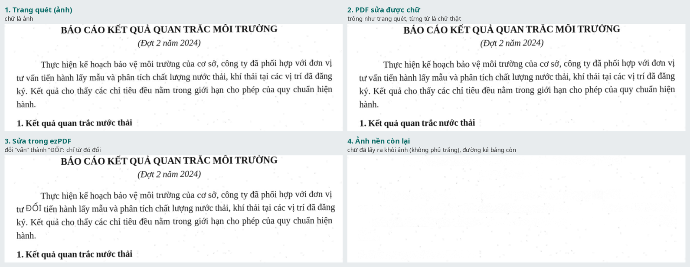

# 13 · Nhận dạng chữ (OCR): Word dựng lại như bản giấy, PDF tìm được chữ (bản 0.9.0), PDF sửa được chữ (bản 0.9.5)

Theo yêu cầu: “thêm tính năng quét orc cho ứng dụng này. làm trên bản cho windows trước. giả sử đưa một ảnh jpeg, png, tiff,.. một file pdf chứa hình… và cho phép quét orc, cho ra kết quả pdf hoặc word”. Sau khi xem bản đánh giá, người dùng xác nhận: kèm sẵn mô hình tiếng Việt trong app, và Word phải dựng lại bảng: “trên hình trong bản pdf là một bảng với các cột thì orc xong cũng phải thành bảng luôn trong word, chứ không phải lấy mỗi text trong bảng”. Tệp báo cáo mẫu chỉ dùng để thử công cụ. Nó nằm trong `mau de test/` (không đưa lên repo).

## Tóm tắt nghiệm thu

| Việc | Trạng thái |
|---|---|
| Chạy trên máy, không gửi tài liệu đi | **Đạt** (thử tự động). Tesseract và mô hình tiếng Việt nằm trong chính ứng dụng (`dist/ocr/`, 7 MB). Khi nhận dạng, trình duyệt không gửi một request nào ra ngoài app (`e2e:ocr`). |
| Ảnh vào: JPEG, PNG, TIFF (nhiều trang), BMP, GIF, WebP; PDF quét | **Đạt.** JPEG giữ nguyên byte trong PDF kết quả. Ảnh khác lưu không mất nét. Khổ trang lấy theo dpi ghi trong ảnh. Ảnh chụp điện thoại xoay theo EXIF. TIFF hai trang ra hai trang. |
| Word dựng lại như bản giấy | **Đạt trên trang thử và trên 8 trang của báo cáo mẫu.** Bảng kẻ thành bảng Word: đúng số cột, số hàng, chiều rộng cột, chiều cao hàng; ô gộp (`gridSpan`, `vMerge`); chỉ kẻ những đường có trên giấy. Tiêu đề hai cột của văn bản hành chính và khối chữ ký thành bảng không viền. Đoạn văn giữ thụt đầu dòng, căn lề, cỡ chữ, đậm, nghiêng. Hình và con dấu cắt từ trang, giữ màu. Dòng đầu trang và chân trang (phía trên, dưới đường kẻ) thành đầu trang, chân trang của Word. Khung viền trang thành viền trang của Word. Mỗi trang giấy là một trang Word, đúng khổ. |
| PDF tìm được chữ | **Đạt.** Trang giữ nguyên, ảnh quét giữ nguyên từng byte. Từng từ được đặt dưới dạng chữ ẩn (chế độ vẽ 3) đúng chỗ của nó trên ảnh. pdf.js, Poppler và MuPDF đều đọc ra cùng một chữ, và vị trí từ lệch dưới 3 pt so với ảnh (đo được khoảng 1,3 pt). Trang đã có chữ được để nguyên. |
| Độ chính xác chữ | Trang thử in sạch (200 dpi, quét giả): **0 % lỗi ký tự**. Báo cáo mẫu (scan khoảng 130 dpi): 0,1 % đến 1,5 % lỗi ký tự trên ba đoạn đã gõ lại để so (bảng dưới). Máy vẫn có thể đọc nhầm: chữ nghiêng nhỏ, chữ quá to trên bìa, chữ bị con dấu đè. |
| Windows | **Đạt trên bản desktop thật chạy Linux** (cùng mã Tauri, WebKitGTK): chọn ảnh qua hộp thoại hệ thống, nhận dạng xong, lưu Word và PDF qua hộp thoại lưu, python-docx và pdf.js đọc đúng, “Mở thư mục” mở đúng chỗ (`smoke-desktop.cjs`, bước 8). Bộ cài Windows mang đủ tệp OCR (CI kiểm). **Chưa chạy trên WebView2 của Windows thật**: xem danh sách tự kiểm ở cuối. |
| PDF sửa được chữ (bản 0.9.5) | **Đạt** (thử tự động, trang thử và 4 trang báo cáo mẫu). Chữ được lấy hẳn ra khỏi ảnh quét và vẽ lại thành chữ thật bằng chính hình của từng từ: trang trông như bản quét, sửa, xóa từng từ bằng Sửa chữ của ezPDF, chỗ cũ trống. Không phủ nền: ảnh trong tệp không còn mực ở chỗ các từ (kiểm bằng cách đọc thẳng ảnh), có thử ngược với bản phủ trắng. Xem mục “PDF sửa được chữ”. |
| Web app, Android | Chưa có (đúng yêu cầu “làm trên bản cho windows trước”). Các bản này không có nút OCR và không mang tệp OCR. |

## Cách dùng (bản Windows)

- **Từ màn hình đầu:** nút **Nhận dạng chữ**, cạnh **Chọn tệp** và **Quét tài liệu**. Chọn một tệp PDF, hoặc một hay nhiều ảnh (giữ Ctrl để chọn nhiều ảnh: mỗi ảnh một trang).
- **Khi đang mở một PDF:** nút **Nhận dạng chữ (OCR)** trên thanh trên cùng, cạnh **Xuất thành ảnh**. App nhận dạng đúng tệp đang thấy (có cả chữ, chữ ký đã thêm).

Trong hộp thoại:

- **Trang** (với PDF): tất cả, trang đang xem, hay các trang như `1-3, 5`.
- **Kết quả:** **Tệp Word (.docx)**, **PDF tìm được chữ** (hai thứ này chọn sẵn), và từ bản 0.9.5 **PDF sửa được chữ** (chọn khi cần, xem mục riêng dưới).
- Bấm **Nhận dạng**. Thanh tiến độ báo trang đang đọc, bấm **Dừng** để thôi. Mỗi trang mất vài giây (bảng dưới).
- Xong thì có nút **Lưu tệp Word…** và **Lưu tệp PDF…** (hộp thoại lưu của Windows, tên gợi ý `tên tệp (OCR).docx` / `.pdf`), **Mở thư mục**, và **Xem trong ezPDF** để mở ngay kết quả trong app (Word mở trên màn hình Word của ezPDF).

## Engine: đánh giá khả năng

Yêu cầu dự án: “Nếu bổ sung sửa chữ có sẵn, OCR hoặc redaction: hãy đánh giá riêng khả năng engine và cách kiểm chứng.” Phần này là đánh giá đó.

**Engine chọn: Tesseract 5 qua tesseract.js 7.0.0** (WebAssembly, chỉ bộ LSTM), mô hình **tiếng Việt `vie` của tessdata_best, bản số nguyên** (gói `@tesseract.js-data/vie` 1.0.0, 1,4 MB nén). Cả hai theo giấy phép Apache-2.0. Lý do chọn:

- Chạy hoàn toàn trong trình duyệt và trong WebView của Tauri, không cần máy chủ, không cần cài gì trên Windows.
- Đọc tiếng Việt có dấu tốt: trên cùng ảnh, tesseract.js cho kết quả như Tesseract 5.3.4 cài sẵn (lỗi ký tự 0,23 %, 0,39 %, 0 % trên ba đoạn mẫu, cả hai). Mô hình `best` đọc tốt hơn `fast` rõ rệt trên scan 130 dpi.
- Cho vị trí từng từ, từng dòng (đường chân chữ) và độ tin cậy. Đó là thứ cần để dựng lại bố cục và đặt lớp chữ ẩn.

Những gì Tesseract **không** làm, nên ezPDF tự làm (`src/ocr/`):

- **Bảng.** Tesseract không hiểu bảng: đọc cả trang thì hàng và cột bị cắt sai, ô ngắn (một con số) hay bị bỏ. ezPDF tự tìm đường kẻ trên ảnh, dựng lưới, rồi đọc **từng ô riêng**. Ô chữ nhỏ (dưới khoảng 10 pt) được phóng gấp đôi trước khi đọc. Ô đọc kém tin cậy được đọc lại theo cách khác (cỡ ảnh, kiểu một dòng hay một khối).
- **Đậm, nghiêng, cỡ chữ.** Bộ LSTM không cho biết chữ đậm hay nghiêng. ezPDF đo trên nét chữ: chữ đậm có nét đứng dày hơn chữ thường của trang khoảng 20 % trở lên. Chữ nghiêng đo trên cả dòng, bằng góc làm các nét đứng thẳng lại. Cỡ chữ tính sao cho Times New Roman chiếm đúng bề ngang của các từ trên giấy. Nhờ vậy dòng trong Word ngắt gần đúng chỗ dòng trên giấy.
- **Chữ viết tay, con dấu, chữ ký, logo** không đọc thành chữ. Chúng được giữ lại dưới dạng hình.

**Độ phân giải đọc:** trang quét được vẽ lại ở gấp đôi độ phân giải gốc, trong khoảng 200–300 dpi. Thử trên báo cáo mẫu (scan 130 dpi) cho thấy 200–250 dpi đọc tốt nhất. Trang không có ảnh quét đọc ở 250 dpi. Trang khổ lớn được hạ dpi để không quá 16 triệu điểm ảnh.

**Tốc độ** (một trang A4): 2–5 giây trong Node và Chromium trên máy CI (`test:ocr`, `e2e:ocr`). Trang có bảng lâu hơn vì mỗi ô một lần đọc. Trên Windows tốc độ tùy máy. Lần đầu mất thêm khoảng một giây để nạp mô hình.

## Cách dựng lại trang

Theo thứ tự (`src/ocr/layout.ts`, `lines.ts`, `pipeline.ts`):

1. **Làm thẳng trang:** đo góc nghiêng của dòng chữ (trang quét đặt lệch), xoay lại nếu lệch từ 0,15° trở lên.
2. **Đường kẻ:** tìm các vệt mực dài và mảnh, ngang và dọc. Đường mờ hay đứt quãng của máy quét được nối lại. Hàng chữ không bị nhầm là đường kẻ: chữ có nét ngắn, và ngay sát một “đường” do chân chữ tạo ra luôn có chữ. Các đường cắt nhau thành bảng. Lưới của bảng là mọi vị trí đường kẻ. Chỗ thiếu đường giữa hai ô là ô gộp. Khung bao gần hết trang là **khung trang**: bảng bên trong khung vẫn được tìm riêng, kể cả bảng tựa vào khung.
3. **Đọc chữ:** trang (đã xóa đường kẻ và bảng) đọc một lần, Tesseract tự chia khối. Dòng chữ to (tiêu đề bìa) đọc lại riêng từng dòng. Sau đó mỗi ô bảng có mực đọc riêng. Đốm bẩn được bỏ trước khi đọc ô: một ô “7,2” sạch từng bị đọc thành “đun” vì vài đốm.
4. **Xếp chữ vào chỗ:** mỗi từ vào ô chứa tâm của nó, còn lại thuộc trang. Dòng có khoảng trống rất rộng bị tách ra. Các mảnh nằm cạnh nhau trên cùng hàng: một hàng thì thành một dòng có điểm dừng tab, nhiều hàng thì thành bảng không viền (tiêu đề hai cột, khối chữ ký). Chữ nằm trên đường kẻ ở đầu trang là đầu trang, dưới đường kẻ ở cuối trang là chân trang. Số trang đứng riêng ở đáy trang cũng là chân trang.
5. **Đoạn văn:** dòng mới thành đoạn mới khi khoảng cách dòng lớn hơn thường lệ, khi dòng trước ngắn, khi đầu dòng có gạch đầu dòng hay số mục (`-`, `+`, `1.`, `a)`, `Điều`, `Chương`…), khi đổi cỡ chữ hay đổi đậm, khi thụt vào. Đoạn có các dòng chạm lề phải thì căn đều hai bên. Tiêu đề căn giữa (theo cột chữ hoặc theo trang, vì lề trái phải ít khi bằng nhau) giữ nguyên chỗ xuống dòng. Khoảng cách giữa các đoạn lấy theo trang giấy.
6. **Hình:** phần mực không phải chữ, không phải đường kẻ, đủ lớn thì là hình. Hình được cắt từ ảnh màu của trang. Hình đứng riêng nằm trong dòng chữ của Word. Hình đè lên chữ (con dấu, chữ ký) thì nằm sau chữ, đúng chỗ trên trang. Khung kẻ quanh một hình vẽ thuộc về hình, không phải bảng một ô.
7. **Word** (`src/ocr/docx.ts`): mỗi trang là một section có khổ giấy, lề lấy theo chỗ chữ nằm, đầu trang, chân trang và viền trang riêng. Phông Times New Roman.

## PDF tìm được chữ

`src/engine/ocr-pdf.ts`, chạy trong worker PDFium của ezPDF. Mỗi từ là một đối tượng chữ **ẩn** (chế độ vẽ 3, như OCR của máy quét), đặt trên đường chân chữ của dòng và giãn ngang cho đúng bề rộng từ trên ảnh, kèm một dấu cách để trình đọc ghép từ. Toạ độ đổi từ điểm ảnh sang toạ độ trang qua `FPDF_DeviceToPage`, nên trang có `/Rotate` (báo cáo mẫu lưu ảnh nằm ngang, xoay 90°) và trang đã làm thẳng đều đúng. Phông ezSans (Latin, tiếng Việt) được nhúng một lần.

Theo đúng ràng buộc của dự án, việc này **không sửa nội dung gốc**: ảnh quét giữ nguyên từng byte, không phủ nền, không vẽ chữ đè lên trang. Lớp chữ chỉ giúp tìm, chọn và chép.

## PDF sửa được chữ (bản 0.9.5)

Theo yêu cầu, kèm ảnh WPS: “công cụ orc của wps sau khi orc xong thì các chữ trên ảnh gốc đã biến thành chữ mà có thể edit được… trông vẫn như ảnh cũ… kéo chữ sang được chỗ khác, chỗ cũ trống trơn luôn. vậy ta có thể làm như vậy được không?”, rồi “cứ thế bắt tay làm”.

**Cách dùng:** trong hộp thoại Nhận dạng chữ, chọn **PDF sửa được chữ** (không chọn sẵn). Xong thì **Lưu tệp PDF…** (tên gợi ý `tên tệp (OCR, sửa được).pdf`) hoặc **Xem trong ezPDF**. Trong ezPDF, bật **Sửa chữ** (phím E), chạm một dòng, đổi hay xóa từ rồi **Lưu dòng**. Thanh sửa báo: “Chữ nhận dạng từ ảnh quét: phần “…” được đặt lại bằng phông ezSans, các từ khác giữ nguyên hình như bản gốc.” **Kéo** một dòng (chuột: kéo thẳng; điện thoại: chạm chọn rồi kéo khung) để dời nó: chỗ cũ trống (`docs/07-sua-chu-va-quet.md`, mục “kéo chữ”).

### Đánh giá khả năng engine

| Cần gì | Engine có gì | Cách làm |
|---|---|---|
| Biết từng từ ở đâu, chữ gì | Tesseract (đã có từ 0.9.0): hộp từng từ, đường chân chữ từng dòng, độ tin cậy | Dùng lại kết quả OCR của trang |
| Lấy chữ ra khỏi ảnh quét (không phủ trắng) | Không engine nào làm sẵn (PDFium chỉ đọc, ghi ảnh) | Tự viết `src/ocr/editable.ts`: trong khung mỗi từ, tách điểm ảnh thành **mực** và **giấy** (xem dưới), sửa chính các điểm ảnh của trang |
| Chữ thật mà trông y ảnh | PDFium không tạo được phông Type 3; viết PDF tay thì làm được | Tự viết `src/ocr/editable-pdf.ts`: mỗi từ là một ký tự của một phông Type 3 riêng, hình của ký tự là hình từ cắt ra từ ảnh |
| Sửa được bằng công cụ Sửa chữ có sẵn | `text-edit.ts` (0.5.0): thay đối tượng chữ, chỉ phần đổi | Mỗi từ một đối tượng chữ; phông OCR mang tên `ezOCR-Words` để công cụ chỉ thay đúng từ bị đổi |

**Lấy chữ ra khỏi ảnh** (từ OCR đọc chắc, độ tin cậy ≥ 55):

- Màu giấy P lấy ở viền khung từ (bỏ mực của chữ bên cạnh), màu mực K là 3 % điểm tối nhất trong từ.
- Mỗi điểm ảnh có độ phủ mực α = vị trí của nó trên đoạn từ P tới K (15 mức). Điểm lệch hẳn màu (con dấu đỏ, nét bút xanh đè lên) không phải mực của từ. Đường kẻ OCR đã tìm thấy (bảng, khung, gạch chân) và mực không nối với chữ của từ (dấu của dòng trên thò xuống) cũng không phải: chúng ở lại trong ảnh.
- Ảnh nền: chỗ mực mỏng thì tách mực ra, B = (I − α·K)/(1 − α), giữ trong độ lấm tấm của giấy; chỗ mực dày thì lấy một điểm giấy quanh từ. Vẽ hình từ (màu K, độ trong α) lên nền thì ra lại ảnh cũ.
- Từ OCR không chắc thì để nguyên trong ảnh, không đụng vào.

**Ghi PDF:** trang mới có đúng một ảnh (ảnh trang không còn chữ, JPEG ở đúng độ phân giải của bản quét) và các từ là chữ. Mỗi từ một ký tự của phông Type 3 (ảnh màu mực kèm mặt nạ mềm α 4 bit), ToUnicode cho ra cả từ, sau mỗi từ một dấu cách bằng đúng khoảng tới từ sau, cả dòng chung một đường chân chữ, các từ xếp theo hàng trên trang để chép ra đúng thứ tự. Cỡ chữ là cỡ thật trên trang, màu tô là màu chữ đọc được, nên từ sửa mới cùng cỡ, cùng màu. Trang mới thay trang quét trong một tệp mới (`buildPages … 'new'`), nên tệp không còn giữ ảnh quét cũ.

Hai chỗ phải chiều PDFium (đã thấy khi thử): PDFium làm tròn khung ảnh ra ngoài rồi kéo giãn ảnh thêm một điểm, nên hình từ được vẽ lùi vào 1/100 điểm ảnh; PDFium gộp đối tượng chữ vào dòng trên khi nó cách dòng đó dưới nửa bề rộng ký tự, mà ký tự ở đây là cả một từ, nên bước tiến của ký tự được giới hạn (1,6 em, và 1,2 lần khoảng cách tới dòng gần nhất), phần còn lại dồn vào dấu cách.

### Cách kiểm chứng

| Bộ thử | Kiểm gì |
|---|---|
| `npm run test:editable` (`tests/editable-test.ts`, CI) | Trang thử OCR (`tests/fixtures/ocr/scan.pdf`, có bảng, nghiêng 0,4°) đi qua đúng các bước của app. 20 điểm: đa số từ được lấy ra (177/179); vẽ lại giống bản quét ở 200 và 400 dpi (sai khác trung bình 0,15 và 0,10 trên 255); trang chỉ có 1 ảnh và đúng số từ là chữ, không hình vẽ nào; chữ đọc lại đúng từng từ, đúng thứ tự, có dấu cách; mỗi dòng của trang thử ra nguyên dòng; **bỏ hết chữ đi thì chỗ các từ trống** (177/177); 18 đường kẻ bảng vẫn còn nguyên trong ảnh; công cụ Sửa chữ thấy các từ thành dòng, đổi một từ thì chỉ thay đúng từ đó (20 từ khác giữ nguyên, từ trước nó giống hệt từng điểm ảnh); xóa một từ thì chỗ đó trống; kéo một dòng xuống chân trang thì cả dòng tới đúng chỗ, chỗ cũ trống, chữ vẫn đọc được (và một dòng của PDF thường cũng dời đúng). |
| `scripts/verify_editable.py` (chạy sau bộ trên) | Làm lại bằng trình đọc khác: qpdf; pikepdf: trang chỉ có 1 ảnh và chữ, không lệnh tô vẽ nào, phông chỉ là phông OCR và mỗi ký tự chỉ vẽ ảnh của nó; MuPDF vẽ giống bản quét, đọc đúng thứ tự từ; **ảnh nền lấy thẳng từ tệp không còn mực ở chỗ các từ**; bỏ chữ khỏi trang thì MuPDF vẽ chỗ các từ trống; đường kẻ còn; tệp đã sửa đọc ra từ mới; tệp có dòng đã kéo: từ ở chỗ thả, chỗ cũ trống. **Thử ngược:** một bản “phủ trắng” (ảnh quét giữ nguyên, vẽ hộp trắng đè lên từ, viết chữ lên trên) trượt 5 điểm, trong đó có “ảnh còn mực ở chỗ các từ” và “có lệnh tô vẽ”. |
| `npm run e2e:ocr` (Chromium thật) | Thêm 11 điểm: lựa chọn có mà không chọn sẵn; chạy trên PDF đang mở; tải về `scan (OCR, sửa được).pdf`; MuPDF vẽ giống bản quét; 1 ảnh JPEG, chữ là phông OCR, không tô vẽ; MuPDF đọc chữ có dấu cách; mở trong ezPDF, Sửa chữ thấy dòng, thanh báo chỉ từ đổi được đặt lại; kéo một dòng bằng chuột thì khung đi theo, thả ra dòng tới chỗ mới; xuất tệp đọc ra từ mới, dòng đã kéo đúng chỗ, chỗ cũ trống, vẫn chỉ 1 ảnh và chữ. |
| Báo cáo mẫu (chỉ trên máy) | Trang 2, 9, 31, 110: đạt hết các điểm của `test:editable` (378/407, 593/600, 509/515 từ được lấy ra; chữ đọc lại 99,7–100 %; ảnh so trước/sau đã gửi người dùng). |

### Giới hạn

- Từ sửa mới đặt bằng phông ezSans (không chân), không trùng phông trên giấy. Từ giữ nguyên thì vẫn là hình gốc.
- Từ OCR đọc không chắc (chữ mờ, chữ trong hình) ở lại trong ảnh, không sửa được.
- Phần gạch chân, đường kẻ chạy qua chữ ở lại trong ảnh; nét chữ nằm trên đường kẻ cũng ở lại.
- Trang có ghi chú (annotation) thì ghi chú được vẽ luôn vào ảnh nền. Mục lục, dấu trang của tệp gốc không được giữ (tệp mới).
- Tệp nặng hơn bản quét khoảng 2–4 lần (ảnh nền JPEG cộng hình từng từ).
- Chỉ bản desktop tạo được tệp (như OCR); mở tệp thì mọi bản sửa, xóa, kéo được. ezPDF kéo cả dòng; WPS, Acrobat… kéo được từng từ.

## Cách kiểm chứng

| Bộ thử | Kiểm gì |
|---|---|
| `npm run test:ocr` (`tests/ocr-test.ts`, chạy trên CI) | Trang thử dựng từ chữ đã biết (`scripts/make_ocr_fixtures.py` → `tests/fixtures/ocr/`): tiêu đề hai cột, tiêu đề, đoạn văn thụt đầu dòng, bảng kẻ 5 × 6 có một ô gộp hai hàng và một ô gộp bốn cột, ghi chú nghiêng, hình, chân trang dưới đường kẻ. Trang bị xoay 0,4°, làm nhòe, rắc đốm như ảnh quét. Đi qua đúng các bước của app: PDF quét → PDFium vẽ → tìm đường kẻ → tesseract.js → dựng trang → Word → PDF. 32 điểm kiểm: góc xoay, tỉ lệ lỗi ký tự, lưới và ô gộp, chữ từng ô, căn giữa, đậm, nghiêng, cỡ chữ, thụt dòng, hình, chân trang, Word (XML hợp lệ, `gridSpan`, `vMerge`, hình, chân trang, khổ giấy), PDF (ảnh giữ nguyên từng byte, pdf.js đọc lại đúng 100 % chữ đã đặt, vị trí từ), JPEG giữ nguyên và đúng dpi, TIFF hai trang đen trắng. |
| `npm run e2e:ocr` (Chromium thật, CI) | Nút trên màn hình đầu (và không có trên web app). Chọn ảnh PNG → nhận dạng → **python-docx** đọc tệp Word đã tải về: bảng 5 cột × 6 hàng, ô gộp, viền, chữ trong ô, tiêu đề hai cột không viền, đoạn văn liền, hình, chân trang, khổ A4. PDF tải về: pdf.js tìm thấy chữ, đúng khổ. TIFF hai trang → PDF hai trang. Tệp không phải ảnh bị từ chối. Từ PDF đang mở: Dừng, rồi chạy lại và mở Word trên màn hình Word của ezPDF. Thanh trên cùng 1280 px vẫn đủ chỗ. Từ bản 0.9.5 thêm PDF sửa được chữ và kéo chữ (11 điểm, mục trên). Không request nào ra ngoài app, không lỗi trang. 31 điểm. |
| `smoke-desktop.cjs` bước 8 (bản desktop thật, WebKitGTK) | Hộp thoại chọn ảnh của hệ thống, nhận dạng trong WebView của Tauri bằng tệp OCR trong app, lưu Word và PDF qua hộp thoại lưu, python-docx và pdf.js đọc lại, “Mở thư mục”. |
| `npm run test:editable` + `scripts/verify_editable.py` | PDF sửa được chữ (bản 0.9.5): xem mục trên. |
| Báo cáo mẫu (chỉ trên máy, không lên repo) | 8 trang khác nhau (bìa có khung, trang chữ, trang có bảng gộp ô, trang trong khung có bảng, hóa đơn có logo và con dấu). Word dựng xong được LibreOffice vẽ ra rồi đặt cạnh trang gốc để so bằng mắt (`tests/ocr-probe.ts`). Ba đoạn đã gõ lại tay dùng để đo tỉ lệ lỗi. Lớp chữ của PDF được vẽ thành khung đỏ đè lên ảnh để xem có khớp từng từ không. |

## Kết quả trên báo cáo mẫu

| Trang | Nội dung | Word dựng được | Thời gian |
|---|---|---|---|
| 1 | Bìa có khung đôi, chữ to | Khung thành viền trang, các dòng căn giữa đúng cỡ. Chữ “BÁO CÁO” cỡ rất to ra “BẢO CÁO” (một dấu sai) | 2,6 s |
| 8 | Chữ, bảng toạ độ 3 cột | Đầu trang và chân trang dưới đường kẻ, bảng 3 × 6, đoạn văn liền | 2,8 s |
| 15 | Hai bảng, một bảng có ô gộp hai hàng | Bảng 6 × 6 có hai ô gộp hai hàng, bảng 6 × 9, đúng một trang Word | 3,3 s |
| 30 | Chữ dày, đoạn căn đều | Đoạn căn đều, thụt dòng, tiêu đề đậm | 4,6 s |
| 110 | Chữ, chữ đậm gạch chân, gạch đầu dòng | Mục đậm, đoạn văn, gạch đầu dòng thụt vào | 4,0 s |
| 140 | Trong khung, bảng 6 cột ở đáy | Khung thành viền trang, bảng 6 × 1 | 3,4 s |
| 165 | Trong khung, bảng 4 × 17 và bảng nhỏ | Hai bảng đầy đủ chữ | 2,8 s |
| 185 | Hóa đơn: logo, con dấu, khung, bảng hàng hóa | Khung, bảng 6 × 12, các đường ngang, logo và dấu thành hình. Hai dòng chữ nhỏ cuối trang tràn sang trang Word thứ hai | 3,3 s |

Tỉ lệ lỗi trên ba đoạn đã gõ lại: trang 30: **0,11 %** ký tự (0,5 % từ); trang 110: **1,17 %** và **1,46 %** ký tự (khoảng 5 % từ: “tắo” thay “tắc”, “biện” thay “hiện”, một chữ “A” bị bỏ). Ảnh gốc của các trang này chỉ khoảng 130 dpi.

## Giới hạn đã biết

- Chữ viết tay không đọc được. Con dấu đè lên chữ làm sai chữ bên dưới.
- Chữ rất to (bìa) có thể sai dấu. Dòng chữ to được đọc lại riêng, vì đọc cả trang thì Tesseract coi dấu của chữ hoa to là đốm bẩn. Chữ nghiêng nhỏ (dưới 9 pt) hay bị nhầm “A” thành “4”.
- Bố cục nhiều cột như báo, tạp chí chưa được dựng thành cột: chữ ra theo thứ tự Tesseract đọc.
- Trang chữ rất dày có thể tràn vài dòng sang trang Word sau, vì phông Times của Word không trùng hẳn phông trên giấy.
- Bảng chỉ có đường ngang, không có đường dọc, chưa thành bảng Word: chữ ra theo dòng, có tab.
- Mỗi trang mất vài giây; tài liệu trăm trang mất vài phút. Có thể bấm Dừng.

## Danh sách tự kiểm trên Windows

1. Cài `ezPDF-0.9.0-windows-setup.exe`. Mở app: màn hình đầu có ba nút **Chọn tệp**, **Quét tài liệu**, **Nhận dạng chữ**.
2. **Nhận dạng chữ** → chọn một ảnh JPEG chụp trang giấy → **Nhận dạng 1 ảnh**. Sau vài giây phải hiện “Đã nhận dạng 1 trang…”.
3. **Lưu tệp Word…** → lưu ra Desktop → mở bằng Microsoft Word: bảng phải là bảng (bấm vào ô thấy con trỏ trong ô), ô gộp giữ nguyên.
4. **Lưu tệp PDF…** → mở bằng Edge → Ctrl F tìm một từ có trên trang: từ đó phải được tô đúng chỗ trên ảnh.
5. Mở một PDF quét nhiều trang → nút **Nhận dạng chữ (OCR)** trên thanh trên → **Các trang** `1-3` → **Dừng** giữa chừng → chạy lại hết.
6. Rút mạng (tắt Wi-Fi) rồi làm lại bước 2: vẫn phải chạy, vì không cần mạng.
7. (Bản 0.9.5) Mở tệp báo cáo quét → **Nhận dạng chữ (OCR)** → chỉ chọn **PDF sửa được chữ**, Các trang `30-31` → **Nhận dạng** → **Xem trong ezPDF**. Trang phải trông như bản quét. Bấm E, chạm một dòng, đổi một từ, **Lưu dòng**: chỉ từ đó đổi (phông ezSans), các từ khác y như cũ, chỗ chữ cũ không còn vết. Xóa một từ: chỗ đó trống. Kéo một dòng xuống lề dưới rồi thả: dòng sang chỗ mới, chỗ cũ trống; Ctrl Z trả về. Ctrl F tìm một từ trên trang: phải thấy.
8. Lưu tệp đó ra, mở bằng WPS hoặc Acrobat: chọn được từng từ, kéo một từ đi thì chỗ cũ trống.

## Tệp

- `src/ocr/raster.ts`: điểm ảnh, tách mực, đo và sửa góc nghiêng, cắt, phóng.
- `src/ocr/lines.ts`: đường kẻ, bảng, ô gộp, khung trang.
- `src/ocr/layout.ts`: dựng trang (đoạn, bảng, hình, đầu trang, chân trang, đậm, nghiêng, cỡ chữ).
- `src/ocr/pipeline.ts`: các bước cho một trang. Dùng chung cho app và cho bộ thử Node.
- `src/ocr/docx.ts`: ghi Word. `src/ocr/times.ts`: bề rộng chữ Times New Roman (lấy từ Liberation Serif, cùng số đo).
- `src/engine/ocr-pdf.ts`: lớp chữ ẩn (PDFium). `src/ocr/images-pdf.ts`: ảnh → PDF.
- `src/ocr/editable.ts`: lấy chữ ra khỏi ảnh (mực, giấy, độ phủ). `src/ocr/editable-pdf.ts`: ghi PDF sửa được chữ (phông Type 3 từng từ). `src/engine/word-pictures.ts`: tên phông để công cụ Sửa chữ nhận ra. `src/ocr/dpi.ts`: độ phân giải đọc và vẽ lại.
- `tests/editable-test.ts`, `scripts/verify_editable.py`: kiểm PDF sửa được chữ.
- `src/ocr/tesseract.ts`, `ocr.worker.ts`, `ocr-client.ts`: chạy Tesseract và các worker. `src/app/ocr/`: hộp thoại.
- `build/ocr-assets.ts`: chép Tesseract và mô hình vào bản desktop (`dist/ocr/`), phục vụ chúng trên dev server.

Giấy phép: tesseract.js, tesseract.js-core (Tesseract 5) và mô hình tessdata_best đều theo Apache-2.0 (`THIRD_PARTY_NOTICES.md`).
